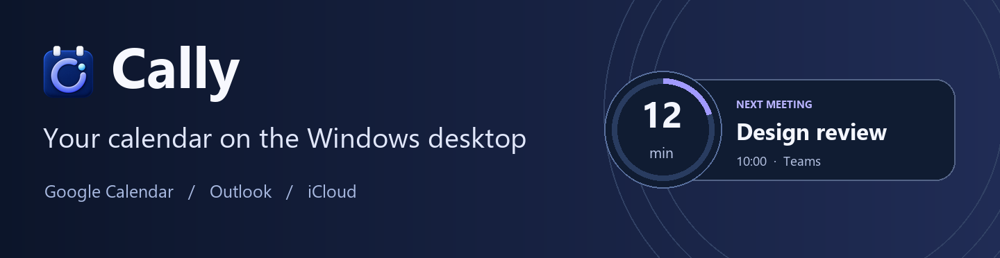

# Cally

A Windows desktop calendar widget with a countdown and collapsible daily agenda. Install the Windows x64 MSI from [GitHub Releases](https://github.com/NomanNasirMinhas/Cally/releases/latest), or build from source with the .NET 9 SDK using `dotnet build -c Release`. Launch with `dotnet run` or open the built Cally.exe.

Choose **Connect a calendar**, select the provider, name the calendar and paste its subscription link. Add more calendars through **All accounts**. Google accepts the secret iCal address. Outlook accepts a published ICS link. iCloud accepts a public calendar link. Outlook and iCloud published calendars can be read by anyone who has their link. Cally does not publish calendars or change provider sharing settings.

Cally refreshes feeds every two minutes. Use the refresh button beside the account selector to fetch all connected calendars immediately, even when Today is collapsed. Feed URLs and preferences are protected with Windows user-scoped encryption. Calendar contents stay in memory. Private and confidential events appear as Busy. The account menu and system tray offer a privacy toggle.

Drag the header to move the widget. Use the account menu to adjust width, refresh, or disconnect the selected calendar. Select a meeting for details. The desktop layer relies on Windows Explorer's icon view. If unavailable, Cally reports that state and opens as a normal window.

Right-click the widget, click the account selector, or left- or right-click the tray icon to open Cally’s menu. **Launch at Windows sign-in** registers the current executable for this Windows user.

### Windows distribution

Each push to `master` builds a versioned GitHub Release. Under **Assets**, download **Cally-win-x64.msi**, run it, and launch Cally from the Start menu. The installer includes the .NET desktop runtime and supports upgrades and removal through Windows Settings. The WiX installer source is in [installer/Cally.wxs](installer/Cally.wxs).

Cally checks GitHub Releases at startup and every 12 hours. Use **Check for updates…** in the widget or tray menu to check immediately. When a newer version is available, select the update in the widget or menu to open its GitHub release page and download the MSI.

In **Connect a calendar** or **Edit calendar**, use the provider button to open Google Calendar settings, Outlook calendar sharing settings, or iCloud Calendar in your browser.
